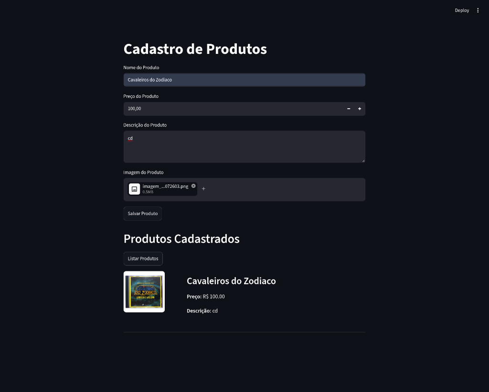
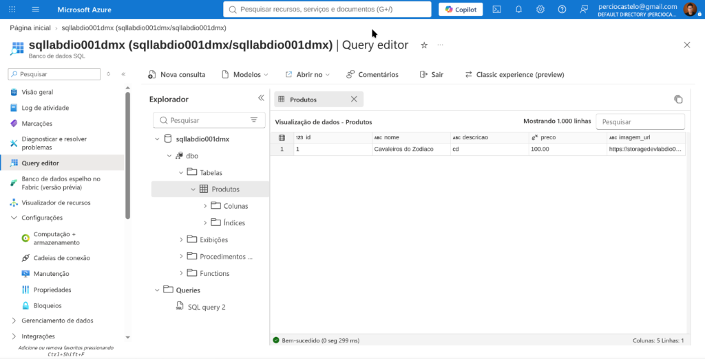
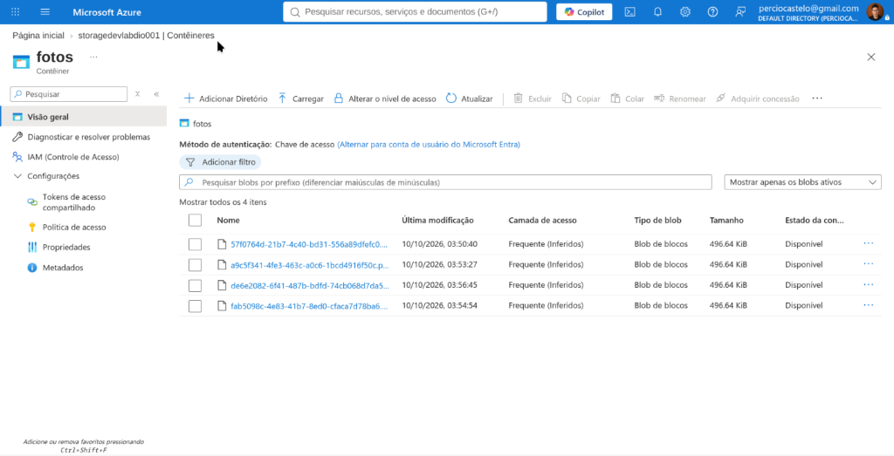
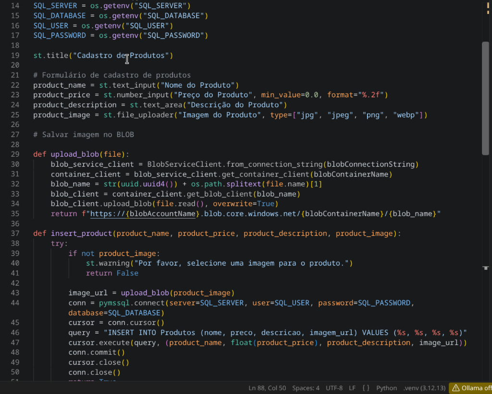

# ☁️ Sistema de Cadastro e Exibição de Produtos com Azure e Streamlit

Projeto desenvolvido como parte do desafio prático de laboratório da **DIO (Digital Innovation One)**, com foco na integração de serviços de nuvem da **Microsoft Azure** (Azure SQL Database e Azure Blob Storage) utilizando Python e Streamlit.

---

## 📌 Visão Geral do Projeto

A aplicação consiste em uma plataforma interativa em **Streamlit** que permite o cadastro completo de produtos comerciais com upload de imagens. A arquitetura desacopla o armazenamento estruturado (metadados do produto) do armazenamento não estruturado (arquivos de mídia/imagens):

- **Azure Blob Storage:** Armazena com segurança os binários das imagens em contêineres gerenciados (`fotos`), gerando UUIDs exclusivos para evitar colisões de nomes.
- **Azure SQL Database:** Persiste os dados relacionais (`nome`, `descricao`, `preco` e a `imagem_url` gerada pelo Blob).
- **Streamlit:** Frontend moderno e responsivo para entrada de dados e visualização imediata do catálogo com renderização das imagens diretamente do Storage.

---

## 📸 Evidências de Funcionamento (Prints)

### 1. Interface Web Funcional (Streamlit)
*Produto cadastrado com sucesso e listado na tela consumindo os dados do Azure SQL e a imagem do Blob Storage:*


---

### 2. Azure SQL Database (Query Editor)
*Registro inserido e validado via Query Editor no portal da Azure:*


---

### 3. Azure Blob Storage (Contêineres)
*Imagem do produto enviada, identificada por UUID e armazenada no contêiner `fotos`:*


---

### 4. Estrutura do Código no VS Code
*Implementação da camada de banco de dados e upload com tratamento de exceções e queries parametrizadas:*


---

## 🛠️ Tecnologias Utilizadas

- **Python 3.12+**
- **Streamlit** — Interface de usuário interativa e ágil
- **Azure Blob Storage SDK (`azure-storage-blob`)** — Gerenciamento e upload de arquivos em nuvem
- **Azure SQL Database & `pymssql`** — Banco relacional corporativo gerenciado
- **python-dotenv** — Isolamento de credenciais e boas práticas de segurança

---

## 🚀 Como Executar Localmente

### 1. Clone o Repositório
```bash
git clone https://github.com/SEU_USUARIO/dio-azure-product-catalog.git
cd dio-azure-product-catalog
```

### 2. Crie e Ative um Ambiente Virtual
```bash
python -m venv .venv

# No Linux/macOS:
source .venv/bin/activate

# No Windows:
.venv\Scripts\activate
```

### 3. Instale as Dependências
```bash
pip install -r requirements.txt
```

### 4. Configure as Variáveis de Ambiente
Copie o arquivo de exemplo `.env.example` para `.env`:
```bash
cp .env.example .env
```
Edite o arquivo `.env` com as suas credenciais reais da Azure:
```env
# Azure Blob Storage
BLOB_CONNECTION_STRING="DefaultEndpointsProtocol=https;AccountName=meustorage;AccountKey=SEU_KEY==;EndpointSuffix=core.windows.net"
BLOB_CONTAINER_NAME="fotos"
BLOB_ACCOUNT_NAME="meustorage"

# Azure SQL Database
SQL_SERVER="meubancodio.database.windows.net"
SQL_DATABASE="meubancodio"
SQL_USER="adminuser"
SQL_PASSWORD="SuaSenhaForte123!"
```

### 5. Crie a Tabela no Azure SQL
Execute o script DDL no Query Editor da Azure ou via cliente SQL:
```sql
CREATE TABLE Produtos (
    id INT IDENTITY(1,1) PRIMARY KEY,
    nome NVARCHAR(255),
    descricao NVARCHAR(MAX),
    preco DECIMAL(18,2),
    imagem_url NVARCHAR(2083)
);
```

### 6. Execute a Aplicação
```bash
streamlit run main.py
```

---

## 💡 Insights e Aprendizados

Durante o desenvolvimento deste laboratório e na resolução dos desafios de integração, destacam-se os seguintes aprendizados:

1. **Separação de Responsabilidades em Nuvem:**
   - Nunca armazenar arquivos binários (BLOBs/imagens) diretamente como base64 ou blob em bancos relacionais. O uso conjunto de **Azure Blob Storage** para ativos estáticos e **Azure SQL** para metadados otimiza custos, melhora a performance de leitura e reduz o tamanho do banco.

2. **Segurança e Queries Parametrizadas:**
   - A interpolação de strings em SQL além de gerar erros de sintaxe (como o `Incorrect syntax near '}'` ao usar literais incorretos), expõe a aplicação a **SQL Injection**. A utilização de tuplas parametrizadas com `%s` no `pymssql` assegura a integridade das transações.

3. **Gerenciamento Seguro de Segredos:**
   - Utilização estrita do `.env` e `.gitignore` para impedir que Connection Strings e senhas mestras da nuvem vazem para repositórios públicos no GitHub. Disponibilizar um `.env.example` documentado é a prática recomendada para portabilidade.

4. **Regras de Firewall e Redes no Azure SQL:**
   - O Azure SQL bloqueia por padrão todo acesso externo. Para conectar via terminal local ou ferramentas de desenvolvimento, é obrigatório registrar o endereço IP público do desenvolvedor nas regras de firewall do servidor no portal Azure (*Networking*).

5. **Nomes Únicos e Colisão de Objetos:**
   - Adotar `uuid.uuid4()` concatenado com a extensão original do arquivo (`os.path.splitext`) garante que o envio de imagens com nomes genéricos (ex: `foto.png`) não sobrescreva ativos de outros produtos.

---

## 📜 Licença

Projeto desenvolvido para fins educacionais e portfólio. Distribuído sob a licença MIT.

